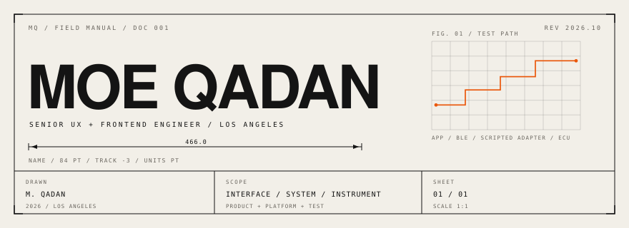
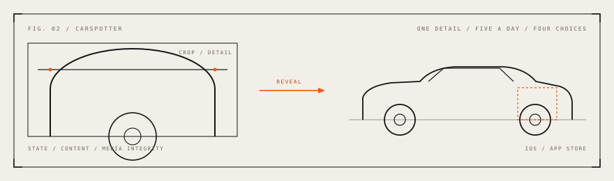
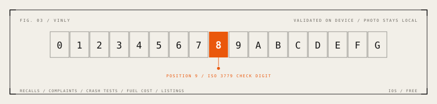
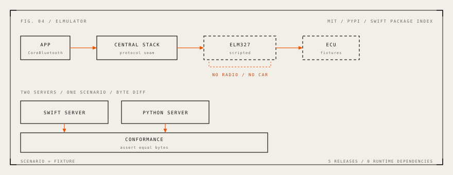
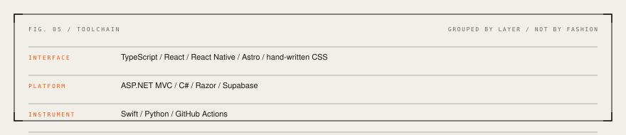

<a href="https://qadan.co/work/" aria-label="Case studies at qadan.co/work">
<picture>
  <source media="(max-width: 600px) and (prefers-color-scheme: dark)" srcset="assets/hero-mobile-dark.svg">
  <source media="(max-width: 600px)" srcset="assets/hero-mobile-light.svg">
  <source media="(prefers-color-scheme: dark)" srcset="assets/hero-dark.svg">
  
</picture>
</a>

Greenfield happens, but most of the work I take on is repair on systems that are already live and have traffic. Design systems, frontend architecture, and accessibility are most of it. So is the build and test tooling around a release.

Outside that I build my own products: two on the App Store, one in field testing, and an open-source test harness that came out of the OBD2 work.

## Products

### CarSpotter

<picture>
  <source media="(prefers-color-scheme: dark)" srcset="assets/carspotter-dark.svg">
  
</picture>

Five cars a day, four choices, then the whole car and a fact. I designed the game and the iPhone app, built the Saturn-led identity, and wrote the ImageMagick pipeline that prepares the photography.

[App Store](https://apps.apple.com/app/carspotter-daily-car-game/id6777868215) · [Case study](https://qadan.co/work/car-spotter/)

### VINly

<picture>
  <source media="(prefers-color-scheme: dark)" srcset="assets/vinly-dark.svg">
  
</picture>

Scan a VIN and get the car's public record: recalls, complaints, crash tests, fuel cost, and listings nearby. The check digit is validated on the phone before any lookup, and the photo never leaves the device.

[App Store](https://apps.apple.com/us/app/vinly-buyer-reports/id6774041303) · [Case study](https://qadan.co/work/vinly/)

### ChatOBD2

An AI mechanic for people who do not want to learn OBD2. Six deterministic reasoning layers run before a model sees the data, and the answer is schema-bound to one sentence a driver can act on. In QA and field testing.

[Case study](https://qadan.co/work/chatobd2/)

## Open source

### elmulator

<picture>
  <source media="(max-width: 600px) and (prefers-color-scheme: dark)" srcset="assets/elmulator-mobile-dark.svg">
  <source media="(max-width: 600px)" srcset="assets/elmulator-mobile-light.svg">
  <source media="(prefers-color-scheme: dark)" srcset="assets/elmulator-dark.svg">
  
</picture>

The iOS Simulator has no radio, and Apple does not let you mock a peripheral, so the Bluetooth layer usually goes untested. elmulator is a scripted ELM327 you can point real CoreBluetooth code at, in CI, with no car and no adapter. A conformance suite keeps the Swift server and the Python server byte-identical. The repository is public and MIT licensed.

[Repository](https://github.com/qadanm/elmulator) · [PyPI](https://pypi.org/project/elmulator/) · [Swift Package Index](https://swiftpackageindex.com/qadanm/elmulator) · [Case study](https://qadan.co/work/elmulator/)

## Platform work

### MagTek

Eleven sites on one ASP.NET MVC codebase. My side is the frontend: a Razor component library past 100 pieces, a CSS foundation rebuilt as tokens, and migrations sequenced so production stays up.

[Case study](https://qadan.co/work/magtek-platform/)

### InvestCloud

Advisor and customer portals for more than fifty wealth and banking institutions ran on one multi-tenant framework, each with its own branding and density. I implemented the frontends and translated the designs, then did it again for the next institution.

[Case study](https://qadan.co/work/financial-platforms/)

## Stack

<picture>
  <source media="(max-width: 600px) and (prefers-color-scheme: dark)" srcset="assets/stack-mobile-dark.svg">
  <source media="(max-width: 600px)" srcset="assets/stack-mobile-light.svg">
  <source media="(prefers-color-scheme: dark)" srcset="assets/stack-dark.svg">
  
</picture>

Most new work is TypeScript and React. MagTek is C# and Razor; the hardware work is Swift and Python.

## Contact

Case studies are at [qadan.co/work](https://qadan.co/work/). [moe@qadan.co](mailto:moe@qadan.co) reaches me.
